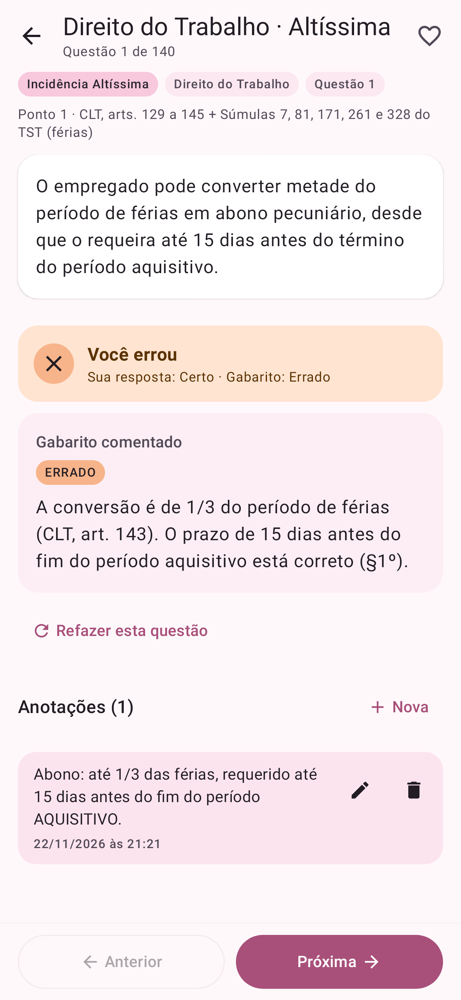
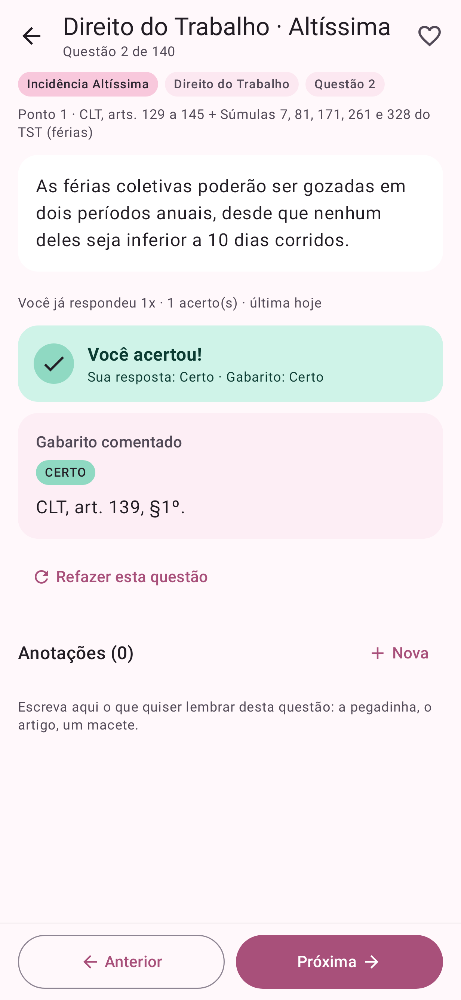
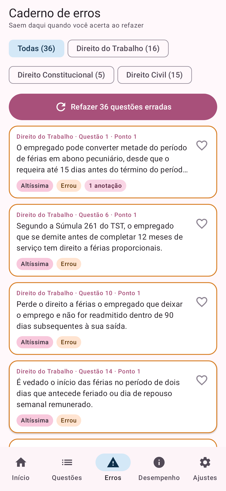
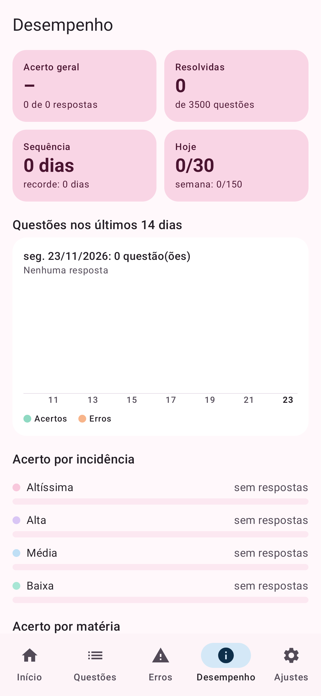

# RevisaQuestõesTRT

App Android pessoal de resolução de questões **Certo ou Errado** para o concurso **TRT-RS – Analista Judiciário** (prova em 31/01/2027), no mesmo padrão visual do [RevisaTRT](https://github.com/RaissaAbreu/RevisaTRT).

<p>







</p>

## Funcionalidades

- **3.500 questões** em 7 matérias, lidas dos PDFs de `dados/pdfs/`.
- **Incidência do assunto** em cada questão: Altíssima, Alta, Média ou Baixa.
- **Responder Certo ou Errado**: o app mostra na hora se você **acertou ou errou** e, logo abaixo, o **gabarito comentado**.
- **Anotações** em cada questão (várias, com editar e apagar). A busca também procura nelas.
- **Filtros** por matéria, por incidência e por situação (não resolvidas, caderno de erros, acertadas, favoritas, com anotações), além de **busca** por palavra.
- **Caderno de erros**: a questão entra quando você erra e sai quando você acerta ao refazer.
- **Desempenho**:
  - % de acerto geral, por matéria e por incidência (todas as tentativas contam);
  - questões por dia (acertos × erros) nos últimos 14 dias e sequência de dias estudando;
  - "assuntos para reforçar": os pontos em que você mais erra.
- **Favoritos**, **metas** diária e semanal, **lembretes** com horários e dias da semana.
- **Contagem regressiva** para a prova.
- **Tema claro/escuro** e cores pastel: rosa bebê, azul bebê, verde-água e roxo claro.
- **Sincronização entre aparelhos** (celular e tablet) com a conta Google: respostas, anotações, favoritos e ajustes (metas, tema, cor, embaralhar). Notificações e lembretes ficam em cada aparelho.
- Funciona **offline**: sem internet, as alterações ficam guardadas e sobem quando a conexão voltar. Seu progresso também entra no backup automático do Android.

## Instalar no celular

1. Abra a página de [Releases](../../releases/latest) pelo celular e baixe o arquivo `RevisaQuestoesTRT-….apk`.
2. Toque no arquivo baixado. Se o Android pedir, autorize "instalar apps desconhecidos" para o navegador ou para o app de arquivos.
3. Para atualizar, instale a versão nova por cima. Suas respostas, anotações e favoritos são mantidos.

## Acrescentar mais questões

1. Envie o PDF novo para a pasta `dados/pdfs/` (no GitHub: **Add file → Upload files → Commit changes**).
2. O GitHub lê os PDFs, monta a base e publica um APK novo em [Releases](../../releases) em poucos minutos.
3. Instale o APK novo por cima do antigo.

O PDF precisa seguir o mesmo formato dos atuais:

- na 2ª linha, `<Matéria> · ...`;
- títulos `Incidência Altíssima|Alta|Média|Baixa` e `Ponto N. <assunto>`;
- itens `N. (   ) <afirmação>`;
- no fim, `Gabarito rápido` e `Gabarito comentado` (`N. CERTO — comentário` / `N. ERRADO — comentário`).

Se algo não bater (questão sem gabarito, gabarito rápido diferente do comentado, numeração com falhas), a geração do APK para. A aba **Actions** do GitHub mostra qual arquivo e qual questão têm o problema.

**Seu progresso é mantido** porque cada questão é identificada pela matéria e pelo texto do enunciado, e não pelo número. Se você corrigir o texto de uma questão, ela passa a contar como questão nova.

## Sincronização (Firebase)

Usa o mesmo projeto Firebase do RevisaTRT (`revisatrt-1`), com login Google e Firestore já ativados. Os dados ficam em `usuarios/{uid}/questoes_respostas`, `questoes_anotacoes`, `questoes_favoritos` e `questoes_ajustes`, separados dos dados do RevisaTRT.

Para ativar neste app, basta fazer isto uma vez:

1. No [console do Firebase](https://console.firebase.google.com/project/revisatrt-1/settings/general), em **Seus apps**, clique em **Adicionar app → Android**:
   - nome do pacote: `app.revisaquestoestrt`;
   - SHA-1: `CB:6E:83:EF:CC:C7:B3:54:23:84:12:A0:CC:B1:1D:E9:F2:BD:43:23`.
2. Ainda em **Seus apps**, no app novo, clique em **Adicionar impressão digital** e cole o SHA-256:
   `0E:7F:2B:05:C9:B6:C0:F3:EA:26:A9:92:DB:FC:4D:75:EC:53:E3:FD:99:EC:C9:30:FE:1A:38:B0:2F:71:E4:7B`.
3. Baixe o `google-services.json` e envie para a pasta `app/` deste repositório.

Se o app mostrar "A nuvem recusou o acesso", confira se as **Regras** do Firestore permitem as subcoleções de `usuarios/{uid}`:

```
rules_version = '2';
service cloud.firestore {
  match /databases/{database}/documents {
    match /usuarios/{uid}/{documento=**} {
      allow read, write: if request.auth != null && request.auth.uid == uid;
    }
  }
}
```

## Desenvolvimento

Kotlin + Jetpack Compose + Room.

- `python3 tools/gerar_questoes.py` gera `app/src/main/assets/questoes.json` a partir dos PDFs. Precisa do `pdftotext` (pacote `poppler-utils`).
- `./gradlew assembleDebug` gera um APK de teste.
- `./gradlew testDebugUnitTest` roda os testes: base de questões, caderno de erros, atualização do banco sem perder progresso, sincronização entre dois aparelhos, e o percurso pelas telas (que salva as capturas em `docs/capturas/`).

Cada push na `main` gera um APK assinado pelo GitHub Actions e publica uma Release. Para isso, o repositório precisa dos segredos `APP_KEYSTORE_B64` (a chave `.jks` em base64, com alias `revisaquestoes`) e `APP_KEYSTORE_PASSWORD`.
