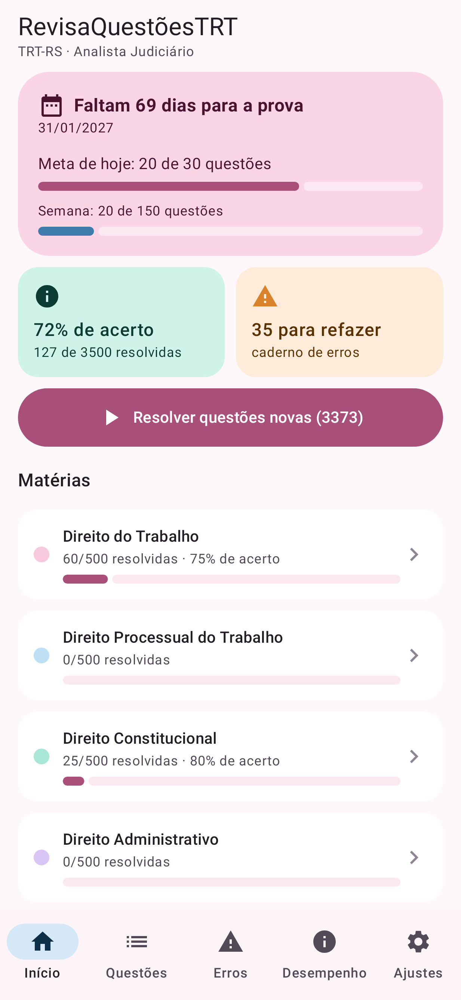
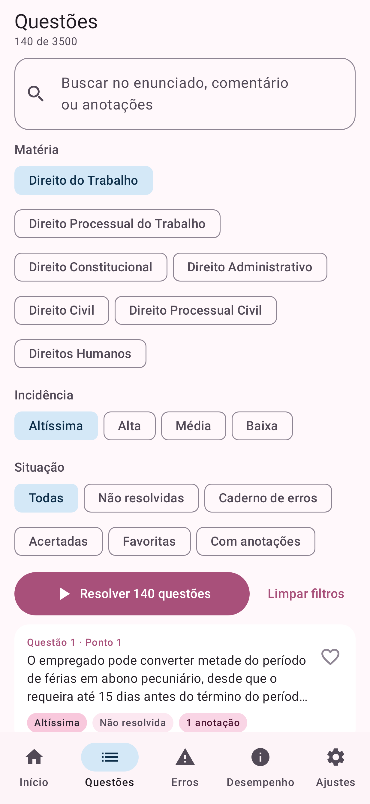
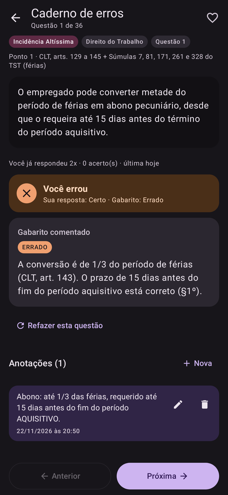

# RevisaQuestõesTRT

App Android pessoal de resolução de questões **Certo ou Errado** para o concurso **TRT-RS – Analista Judiciário** (prova em 31/01/2027), no mesmo padrão visual do [RevisaTRT](https://github.com/RaissaAbreu/RevisaTRT).

## Funcionalidades

- **3.500 questões** em 7 matérias, lidas dos PDFs de `dados/pdfs/`.
- **Incidência do assunto** em cada questão: Altíssima, Alta, Média ou Baixa.
- **Responder Certo ou Errado**: o app mostra na hora se você **acertou ou errou** e, logo abaixo, o **gabarito comentado**.
- **Anotações** em cada questão (várias, com editar e apagar). A busca também procura nelas.
- **Filtros** por matéria, por incidência e por situação (não resolvidas, caderno de erros, acertadas, favoritas, com anotações), além de **busca** por palavra.
- **Caderno de erros**: a questão entra quando você erra e sai quando você acerta ao refazer.
- **Desempenho**:
  - % de acerto geral, por matéria e por incidência (todas as tentativas contam);
  - questões por dia (acertos × erros) nos últimos 14 dias e sequência de dias estudando;
  - "assuntos para reforçar": os pontos em que você mais erra.
- **Favoritos**, **metas** diária e semanal, **lembretes** com horários e dias da semana.
- **Contagem regressiva** para a prova.
- **Tema claro/escuro** e cores pastel: rosa bebê, azul bebê, verde-água e roxo claro.
- Funciona **offline**. Seu progresso entra no backup automático do Android.

## Instalar no celular

1. Abra a página de [Releases](../../releases/latest) pelo celular e baixe o arquivo `RevisaQuestoesTRT-….apk`.
2. Toque no arquivo baixado. Se o Android pedir, autorize "instalar apps desconhecidos" para o navegador ou para o app de arquivos.
3. Para atualizar, instale a versão nova por cima. Suas respostas, anotações e favoritos são mantidos.

## Acrescentar mais questões

1. Envie o PDF novo para a pasta `dados/pdfs/` (no GitHub: **Add file → Upload files → Commit changes**).
2. O GitHub lê os PDFs, monta a base e publica um APK novo em [Releases](../../releases) em poucos minutos.
3. Instale o APK novo por cima do antigo.

O PDF precisa seguir o mesmo formato dos atuais:

- na 2ª linha, `<Matéria> · ...`;
- títulos `Incidência Altíssima|Alta|Média|Baixa` e `Ponto N. <assunto>`;
- itens `N. (   ) <afirmação>`;
- no fim, `Gabarito rápido` e `Gabarito comentado` (`N. CERTO — comentário` / `N. ERRADO — comentário`).

Se algo não bater (questão sem gabarito, gabarito rápido diferente do comentado, numeração com falhas), a geração do APK para. A aba **Actions** do GitHub mostra qual arquivo e qual questão têm o problema.

**Seu progresso é mantido** porque cada questão é identificada pela matéria e pelo texto do enunciado, e não pelo número. Se você corrigir o texto de uma questão, ela passa a contar como questão nova.

## Desenvolvimento

Kotlin + Jetpack Compose + Room.

- `python3 tools/gerar_questoes.py` gera `app/src/main/assets/questoes.json` a partir dos PDFs. Precisa do `pdftotext` (pacote `poppler-utils`).
- `./gradlew assembleDebug` gera um APK de teste.
- `./gradlew testDebugUnitTest` roda o teste que confere a base e a lógica do caderno de erros, percorre as telas e salva as capturas em `docs/capturas/`.

Cada push na `main` gera um APK assinado pelo GitHub Actions e publica uma Release. Para isso, o repositório precisa dos segredos `APP_KEYSTORE_B64` (a chave `.jks` em base64, com alias `revisaquestoes`) e `APP_KEYSTORE_PASSWORD`.
